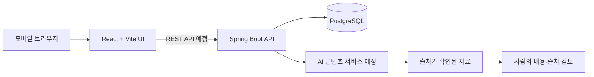

# 디쇼츠 (De-Shorts)

역사적·현대 인물을 팔로우하고, 카드뉴스 피드에서 인물의 사상과 사건을 짧게 읽는 지식 콘텐츠 서비스입니다. 숏폼을 여러 형식으로 바꾸는 서비스가 아니라 **인물 발견 → 팔로우 → 게시물 읽기 → 저장 또는 관련 인물 탐색**에 집중합니다.

> **현재 상태 (2026-10-14):** 이 저장소는 React + Vite로 만든 프런트엔드 시안입니다. 인물·게시물은 샘플 데이터이고, 인터랙션은 브라우저 상태와 `localStorage`로 동작합니다. 백엔드 API와 새 컨셉의 AI 콘텐츠 생성은 아직 연결하지 않았습니다.

## 해결하려는 문제와 목표

짧은 휴식 시간에 교양 콘텐츠를 찾아보려면 여러 자료를 직접 검색하고 맥락을 연결해야 합니다. 디쇼츠는 관심 있는 인물을 따라가며 사상·생애·당대 사건을 카드뉴스로 발견하게 돕습니다. 사용 시간을 줄이거나 학습 효과를 입증했다고 주장하지 않고, 발표에서는 탐색과 읽기 흐름이 동작하는지 보여주는 것을 목표로 합니다.

## 핵심 사용자 흐름

1. 홈 피드나 탐색에서 인물 또는 주제를 발견합니다.
2. 인물 프로필에서 시대·분야·소개를 읽고 팔로우합니다.
3. 여러 장의 게시물 카드를 넘겨 보며 맥락을 확인합니다.
4. 출처를 열고, 게시물을 저장하거나 관련 인물·주제로 이동합니다.

## 화면과 주요 기능

- **홈 피드:** 인물 소개와 카드뉴스 게시물을 세로로 탐색하고, 한 게시물 안에서는 카드를 넘깁니다.
- **인물 프로필:** 활동 시대, 분야, 소개, 팔로우 상태와 게시물 목록을 보여줍니다.
- **탐색:** 인물·주제 검색과 관련 게시물 이동을 제공합니다.
- **저장함:** 나중에 읽을 게시물을 다시 엽니다.
- **게시물 상세·출처:** 카드의 맥락과 참고 자료를 보여줍니다.

현재 UI 시안에는 Stories, Reels, DM 등 실험 화면도 남아 있습니다. 이 기능들은 현재 기획의 MVP에 포함하지 않았으며, 발표 범위에 넣을지 별도 결정이 필요합니다.

## 시스템 구성



React + Vite와 Spring Boot + PostgreSQL은 기존 프로토타입에서 사용한 기술입니다. 새 인물 피드 컨셉에 대한 데이터 모델과 API 계약은 아직 확정하지 않았습니다. AI 서비스 제공자·모델도 미정입니다.

## 생성형 AI 활용 계획

MVP에서는 사용자가 선택한 인물·주제와 사람이 확인한 참고 자료를 입력으로 받아, 카드뉴스 초안(짧은 제목·설명·캡션·관련 주제)을 만드는 방안을 검토합니다. AI는 글의 구성과 쉬운 설명을 돕고, 원문 인용과 재구성한 설명을 구분하도록 합니다. 운영자가 주장과 출처를 확인한 뒤 게시물로 사용하며, 링크가 있다는 이유만으로 AI가 사실을 검증했다고 표시하지 않습니다. 초기 피드 순서와 관련 인물 연결은 팔로우·주제 데이터에 따른 규칙 기반으로 처리하는 방향입니다.

**미정:** 모델·API 제공자, 자료 수집 방식, 초기 인물·게시물 수, 이미지 라이선스와 제작 방식, 새 컨셉의 계정·댓글 범위.

## 구현 현황

| 영역 | 현재 구현 | 남은 작업 |
| --- | --- | --- |
| 프런트엔드 | React + Vite 모바일 UI, 인물·게시물 샘플, 탐색·프로필·팔로우·저장·카드 넘기기. 상태는 브라우저에 저장 | 새 MVP 범위로 화면 정리, 실제 데이터 API 연결 |
| 백엔드 | 별도 [Spring Boot 저장소](https://github.com/dud1111122/DMU_3-2_AIproject_BE)에 이전 카드 컨셉의 샘플 API와 PostgreSQL JPA 모델 | 인물·게시물 API로 재설계, 프런트엔드 연동 |
| 생성형 AI | 새 컨셉에는 미연결 | 모델·제공자 선정, 출처 기반 초안 생성, 검토 절차 구현 |
| 데이터·출처 | 이 저장소의 콘텐츠는 시연용 샘플 | 콘텐츠별 실제 출처 URL과 사람 검토 기록을 관리 |

샘플 인물·게시물과 이미지는 시연 데이터입니다. 모든 카드 문장이 검증된 사실을 의미하지 않습니다.

## 개발 일정

| 기간 | 결과물 | 완료 기준 |
| --- | --- | --- |
| 10/14–10/18 | 새 컨셉 MVP·화면·제외 범위 확정 | 피드·프로필·탐색·저장 흐름과 Stories/Reels/DM 제외 여부를 문서화 |
| 10/19–10/25 | 인물·게시물·카드·출처 데이터 구조 및 API 초안 | FE-BE 요청·응답 형식과 로컬 저장 범위 확정 |
| 10/26–11/01 | 출처 기반 카드 작성 흐름과 샘플 콘텐츠 | 3개 인물의 카드 게시물 초안, 출처 링크, 사람 검토 기준 준비 |
| 11/02–11/08 | UI와 API 연결, 팔로우·검색·저장 흐름 | 주요 화면에서 데이터가 이어지고 새로고침 뒤 저장 상태가 유지됨 |
| 11/09–11/15 | 예외 흐름 점검과 발표 준비 | 빈 상태·오류·출처 확인 시연, 발표용 30초 경로와 백업 준비 |
| 11/16–11/18 | 최종 확인 및 수업 발표 | 최신 코드·시연 경로·남은 한계를 구분해 발표 |

## 실행 방법

```bash
npm install
npm run dev
```

Vite 개발 서버가 표시하는 주소를 브라우저에서 엽니다. `npm run build`는 정적 배포용 번들을 만듭니다.

## 기술 스택

- React
- Vite
- Tailwind CSS 4
- 브라우저 `localStorage` (시연용 팔로우·저장·좋아요 상태)

## 코드 구성

- `src/App.jsx`: 화면 전환과 앱 상태
- `src/screens/`: 홈 피드, 탐색, 인물 프로필, 게시물 상세, 저장함 등
- `src/components/`: 게시물·아바타·스토리·내비게이션 UI
- `src/data/content.js`: 시연용 인물·게시물 데이터
- `src/hooks/usePersistedState.js`: 브라우저 로컬 상태 저장
- `src/styles.css`: 공통 레이아웃과 화면 스타일

## 공개 저장소

- 프런트엔드: https://github.com/dud1111122/DMU_3-2_AIproject_FE
- 백엔드: https://github.com/dud1111122/DMU_3-2_AIproject_BE
