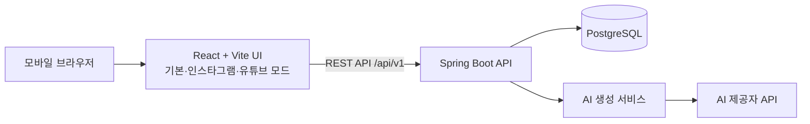

# 디쇼츠 (De-Shorts)

> 서비스 기획의 기준 문서는 상위 프로젝트 폴더의 `기획/기획.md`이고, API 계약은 `기획/BE_Endpoint.md`입니다. 이 README와 기획서가 다르면 기획서를 따릅니다.

익숙한 숏폼·소셜 미디어 인터페이스(기본·인스타그램·유튜브 쇼츠 스타일)로 교양과 지식 콘텐츠를 보는 서비스입니다. 각 지식 인물은 AI 페르소나로 구현되어 인물의 관점과 말투로 카드뉴스를 게시하고, 사용자와 학습 대화를 나눕니다.

> **현재 상태 (2026-10-28):** 이 저장소는 React + Vite로 만든 프런트엔드 시안입니다. 인물·게시물은 샘플 데이터이고, 인터랙션은 브라우저 상태와 `localStorage`로 동작합니다. 백엔드 API와 AI 콘텐츠 생성은 아직 연결하지 않았습니다.

## 해결하려는 문제와 목표

쇼츠나 릴스를 보며 보내는 짧은 휴식 시간을 교양과 지식을 쌓는 시간으로 바꿉니다. 관심 주제와 인물을 고르면 AI가 카드뉴스와 학습 포인트·퀴즈를 생성해 바로 피드에 보여주고, 사용자는 페르소나와의 대화로 이해를 확인하고 복습합니다. 사용 시간을 줄이거나 학습 효과를 입증했다고 주장하지 않고, 발표에서는 탐색·읽기·학습 흐름이 동작하는지 보여주는 것을 목표로 합니다.

## 핵심 사용자 흐름

1. 관심 분야를 고르고, 기본·인스타그램·유튜브 쇼츠 모드 중 하나를 선택합니다.
2. AI가 관심 주제의 게시물을 생성해 바로 피드에 게시합니다.
3. 페르소나 프로필에서 시대·분야·소개와 AI 재현 안내를 확인하고 팔로우합니다.
4. 카드를 넘겨 읽고, 참고 문헌을 확인하거나 게시물을 저장합니다.
5. 게시물을 만든 페르소나와 채팅하며 배운 내용을 설명하고, 학습 포인트 기준 피드백을 받습니다.
6. 퀴즈 오답과 놓친 학습 포인트를 복습합니다.

## 화면과 주요 기능

- **홈 피드:** 인물 소개와 카드뉴스 게시물을 세로로 탐색하고, 한 게시물 안에서는 카드를 넘깁니다.
- **인물 프로필:** 활동 시대, 분야, 소개, AI 재현 안내, 팔로우 상태와 게시물 목록을 보여줍니다.
- **탐색:** 인물·주제 검색과 관련 게시물 이동을 제공합니다.
- **저장함:** 나중에 읽을 게시물을 다시 엽니다.
- **게시물 상세·출처:** 카드의 맥락, 학습 포인트, 참고 문헌을 보여줍니다.
- **모드 선택:** 기본·인스타그램·유튜브 쇼츠 모드로 같은 콘텐츠를 다르게 표현합니다. 유튜브 쇼츠 모드는 인터페이스만 따르며, 영상 없이 기존 카드를 세로 전체 화면으로 보여줍니다.
- **난이도 (인스타 모드 시안, 변형 생성은 AI 연결 후):** 기본 난이도(쉬움·보통·어려움)를 설정하고, 게시물 상세에서 "더 쉽게"·"더 어렵게"로 이동합니다.
- **페르소나 토론 (인스타 모드 시안, 시연용 토론 1개):** 페르소나 두 명과 논제를 골라 짧은 가상 토론과 쟁점 요약을 봅니다. 하루 생성 횟수가 제한됩니다.
- **페르소나 학습 채팅 (시연 답변, 이해 평가는 AI 연결 후):** 게시물 맥락으로 페르소나와 대화하고 이해 평가를 받습니다.
- **이해 확인·복습 (인스타 모드 시안):** 퀴즈 결과와 해설, 복습 항목을 보여줍니다.

인스타그램 모드는 기획서에 맞춰 정리했습니다(2026-10-28). 스토리·릴스·댓글처럼 기획에 없는 화면은 지웠습니다. 대신 AI 재현 표시, 학습 포인트, 난이도 이동, 이해 확인 퀴즈와 복습, 페르소나 학습 채팅, 페르소나 토론, 신고, 기본 난이도·관심 주제 설정을 넣었습니다. 난이도 변형 생성과 새 토론 생성은 AI 연결 전이라 안내 문구나 시연용 토론으로 대신합니다.

## 시스템 구성



화면 모드별 API는 따로 두지 않습니다. 같은 API 응답을 모드별 컴포넌트가 다르게 표현하고, 좋아요·저장·팔로우·학습 기록은 모든 모드에서 같은 상태를 사용합니다.

## 생성형 AI 활용

- 관심 주제와 페르소나 설정으로 게시물(제목·캡션·카드 섹션)과 학습 포인트·퀴즈를 생성합니다. 현재는 참고 자료 없이 모델 지식으로 생성하며(`groundingMode: MODEL_KNOWLEDGE`), 자료 기반 생성은 이후 단계에서 추가합니다.
- 생성 결과는 형식 검증만 거쳐 사람의 검토 없이 바로 게시합니다. 문제가 있는 게시물은 신고와 숨김으로 처리합니다.
- 화면에서 직접 인용과 AI 재구성 설명, AI가 제시한 참고 문헌(`verified: false`)과 확인된 출처를 구분해 표시합니다.
- AI 제공자 API 키는 백엔드 환경 변수로만 설정하며 프런트엔드에는 두지 않습니다.

## 구현 현황

| 영역 | 현재 구현 | 남은 작업 |
| --- | --- | --- |
| 프런트엔드 | React + Vite 모바일 UI, 기본·인스타그램·유튜브 쇼츠 모드, 인물·게시물 샘플(학습 포인트·퀴즈 포함), 팔로우·좋아요·저장, 페르소나 채팅(시연 답변), 인스타 모드의 퀴즈·복습·토론·신고. 상태는 브라우저에 저장 | 기본·쇼츠 모드에 퀴즈·토론 연결, 실제 데이터 API 연결 |
| 백엔드 | 별도 [Spring Boot 저장소](https://github.com/dud1111122/DMU_3-2_AIproject_BE)에 이전 카드 컨셉의 샘플 API와 PostgreSQL JPA 모델 | `기획/BE_Endpoint.md` 기준으로 재설계, 프런트엔드 연동 |
| 생성형 AI | 미연결 | API 키 설정, 게시물·학습 포인트·퀴즈 생성과 자동 게시, 페르소나 채팅 |
| 데이터·출처 | 이 저장소의 콘텐츠는 시연용 샘플 | AI 생성 게시물로 대체, 근거 유형·참고 문헌 표시 |

샘플 인물·게시물과 이미지는 시연 데이터입니다. 모든 카드 문장이 검증된 사실을 의미하지 않습니다.

## 개발 일정

일정은 `기획/기획.md`의 "기존 프로젝트 일정"을 따릅니다.

## 실행 방법

```bash
npm install
npm run dev
```

Vite 개발 서버가 표시하는 주소를 브라우저에서 엽니다. `npm run build`는 정적 배포용 번들을 만듭니다.

## 기술 스택

- React
- Vite
- Tailwind CSS 4
- 브라우저 `localStorage` (시연용 팔로우·저장·좋아요 상태)

## 코드 구성

- `src/App.jsx`: 화면 모드 선택
- `src/InstagramApp.jsx`, `src/screens/`, `src/components/`: 인스타그램 모드 화면
- `src/modes/basic/`, `src/modes/shorts/`: 기본·유튜브 쇼츠 모드 화면
- `src/shared/`: 모든 모드가 함께 쓰는 활동·대화·설정·학습 기록 훅과 콘텐츠 도우미
- `src/data/content.js`: 시연용 인물·게시물·학습 포인트·퀴즈·토론 데이터
- `src/data/personaChat.js`: 백엔드 연결 전 시연용 페르소나 답변
- `src/hooks/usePersistedState.js`: 브라우저 로컬 상태 저장
- `src/styles.css`: 공통 레이아웃과 화면 스타일

## 공개 저장소

- 프런트엔드: https://github.com/dud1111122/DMU_3-2_AIproject_FE
- 백엔드: https://github.com/dud1111122/DMU_3-2_AIproject_BE
